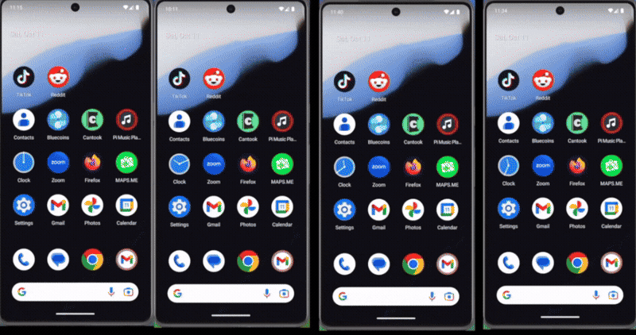

English · [Chinese](README_CN.md)

<div align="center">

# PhoneGo: Personal AI Agent on Your Phone

**CLI+GUI · Fast · Powerful · Reliable · Cost-Effective Phone-Use Agent**

<p>
  <a href="https://github.com/HKUDS/PhoneGo/releases/download/phonego-v0.4.4/PhoneGo-0.4.4-arm64.apk"></a>
  <a href="#-how-to-use-phonego"></a>
</p>
<p>
  <a href="./Communication.md"></a>
  <a href="./Communication.md"></a>
  <a href='https://arxiv.org/abs/2609.35671'></a>
  <a href='https://arxiv.org/abs/2510.22009'></a>
</p>

</div>

Download PhoneGo and run it directly on your Android Phone.

Tell PhoneGo what you want. It opens and operates the right apps, gets the task done, and reports back.

- **Download and run** directly on your phone.
- **Describe the task** in natural language.
- **Let PhoneGo operate** the relevant apps.
- **PhoneGo works in the background**, so your phone remains yours to use.
- **Get the result** when the task is complete.

## What Makes PhoneGo Different?

### ⚡ Reusable App Commands

PhoneGo turns familiar app workflows into reusable commands:

- Open a specific page.
- Search for information.
- Complete a booking or other multi-step task.
- Replay tested workflows without rediscovering every tap.

**Result:** faster execution, more consistent outcomes, and fewer model calls.

### 📱 Visual App Interaction

For apps that require direct screen interaction, PhoneGo can:

- Understand what is displayed on the screen.
- Tap buttons and navigate menus.
- Scroll through pages and return to previous screens.
- Handle unfamiliar interfaces and unexpected app states.

**Result:** PhoneGo can work with apps even when no API or reusable command is available.

### 🔀 CLI (Command) + GUI (Visual) Execution

PhoneGo automatically chooses the most suitable approach:

- **Reusable commands** for familiar, repeatable workflows.
- **Visual interaction** when tapping or scrolling is required.
- **Vision models** only for unfamiliar screens or new situations.
- **Seamless switching** between commands and visual operations within the same task.

**Result:** command-level speed and reliability, with the flexibility of human-like app interaction.

## 🎬 Use Case

```
you   find a hotel near HKU on Xiaohongshu, pick one, then check tonight's price on Ctrip

app   · Xiaohongshu: search → open a note → "Hopewell Hotel"
      · Ctrip: search Hopewell Hotel → 17–18 Nov
      · tonight: "no rooms for the dates you picked". Next available —
        18–19 Nov from CNY 3379 · 19–20 Nov from CNY 3790 · 20 Nov from CNY 2303
      · want me to move this hotel page to your phone to continue?
```

<p align="center">
  
</p>


## ✨ Key Features of PhoneGo

| | |
|---|---|
| 🗺️ **Builds an executable map of each app** | Screens and navigation paths become reusable commands. |
| 🧭 **Calls commands instead of guessing every tap** | Known paths run quickly and deterministically without vision calls. |
| 👁️ **Looks only when the map runs out** | Vision handles unfamiliar screens and dynamic content. |
| 🔀 **Combines commands with visual interaction** | Commands bring speed; visual interaction handles change. |
| 🔗 **Carries context across apps** | Information found in one app flows directly into the next. |
| 📵 **Works without taking over your phone** | PhoneGo runs in the background whenever possible. |
| ↩️ **Returns control when finished** | It uses the main screen only when required, then gives it back. |
| 🔒 **Keeps sensitive state on your device** | Maps, keys, sessions, and settings remain local. |

> **Commands handle what is known. Vision handles what is new.**

<p align="center">
  
</p>

## ⚙️ From App Screens to Callable Commands

PhoneGo separates what can be prepared in advance from what must be understood at runtime:

```text
OFFLINE    Explore the app → Build its navigation map        (once per app)
ONLINE     Understand the task → Select and replay a command  (fast path)
FALLBACK   Encounter something new → Use visual interaction   (only when needed)
```

## 📊 Tested on a Real Phone

We ran the same instruction on the same phone and compared PhoneGo's map-and-replay approach with a vision-only agent.

| Task | PhoneGo: Map + Replay | Vision Only |
|---|---:|---:|
| Find how to book an HKU visit on Xiaohongshu | **17 steps · 64 s · 92.3k tokens** | 32 steps · 146 s · 207.1k tokens |

Both approaches completed the task successfully—but PhoneGo used:

- **47% fewer steps**
- **56% less time**
- **55% fewer tokens**

The difference comes from a simple idea: familiar navigation is replayed as a tested command instead of being visually rediscovered step by step.

See the side-by-side recordings in [docs/showcase/](docs/showcase/).

## 📲 How to Use PhoneGo

PhoneGo runs directly on your Android phone—no computer required.

### 1. Download and Install

Download **[PhoneGo-0.4.4-arm64.apk](https://github.com/HKUDS/PhoneGo/releases/download/phonego-v0.4.4/PhoneGo-0.4.4-arm64.apk)**.

**Requirements:** Android 14+ · ARM64

Open the APK and allow installation from this source. On MIUI devices, tap **Continue** when prompted.

If the APK will not install, or the app will not pair once it is open, the exact
sentence on screen is listed in **[Errors and fixes](docs/errors.md)**.

### 2. Connect PhoneGo to Your Phone

PhoneGo uses Android’s built-in wireless debugging to operate apps locally.

1. Turn on **Wireless debugging** in Developer options.
2. Enable the **PhoneGo Accessibility Service**.
3. Follow the in-app pairing instructions.

PhoneGo reads the pairing code from the system dialog and connects to the phone’s local `adbd` service automatically.

> **No USB cable or separate computer is needed.**

### 3. Connect a Model

Go to **Settings → Model Settings**.

1. Tap **Provider** and pick one: DeepSeek (official), DeepSeek, OpenRouter,
   Zhipu, Alibaba Bailian, SiliconFlow, Moonshot Kimi, OpenAI, Gemini, Anthropic,
   a local endpoint, or **Custom** for any other compatible endpoint. Picking one
   fills the base URL and the model for you.
2. Enter your API key — a `sk-or-v1-…` key selects OpenRouter by itself.
3. Everything else (model id, base URL, vision model, step budget) is under
   **Advanced**. Saving runs the connection test and tells you the result.

PhoneGo does not bundle a model or API key, so you remain in control of the model endpoint it uses.

### 4. Give PhoneGo a Task

Type your request in natural language.

For your first run, try a task that does not require login:

> *Open Settings and tell me which Wi-Fi network is connected.*

PhoneGo will open the app, perform the necessary steps, and report the result.

**If a step does not work**, the sentence on screen is the fastest way in:
**[Errors and fixes](docs/errors.md)** lists what the app can print — pairing,
the local agent, the model key, maps — with the cause and what to do about each.

## 🌐 Language and Updates

- PhoneGo supports **English and Chinese**.
- The interface follows your phone’s system language by default.
- You can change it manually under **Settings → Language**.
- New releases can be installed over the existing version without removing your current setup.

For a complete visual walkthrough and troubleshooting guide, see **[Getting Started](docs/getting-started.md)**.

## ❓ Frequently Asked Questions

### Does PhoneGo upload my screen?

Only when visual understanding is required.

In that case, the relevant screen is sent to the model endpoint you configured. The following remain on your device:

- App Navigation Maps
- Pairing keys
- Sessions
- Settings
- Reusable commands

Known workflows can run from the local map without sending every screen to a vision model.

### Do I need a computer?

No.

PhoneGo runs directly on your phone and connects through Android’s built-in wireless debugging.

A USB connection to a computer is supported for development, but it is not required for normal use.

### Which apps can PhoneGo operate?

PhoneGo can work with apps that can be operated through tapping, scrolling, and text input.

- **Mapped apps** use fast, reusable commands for familiar navigation.
- **Unmapped screens** fall back to visual interaction.
- **Changed interfaces** can be explored again and their maps rebuilt.

Apps with an existing map are typically faster and require fewer model calls.

### Can PhoneGo make purchases for me?

PhoneGo does not complete sensitive actions without your confirmation.

Before actions such as paying, placing an order, or submitting a transaction, it pauses and asks you to approve.

Passwords, verification codes, and other sensitive authentication steps are handed back to you.

This is the default. Settings has a switch, **Never ask me about money**, which
turns the question off (it asks once before you enable it, and it also applies to
shell commands that change the phone).

### Something went wrong — where do I look?

Start with the sentence the app printed. **[Errors and fixes](docs/errors.md)** is
indexed by that wording: what it means, what to do, and which section of the
[manual](docs/manual.md) has the rest. If it is not there, open an issue with the
sentence and what you had just done.

## 📚 Documentation

Not sure where to begin? Start with **[Getting Started](docs/getting-started.md)** to install PhoneGo and complete your first task.

| Guide | What You’ll Find |
|---|---|
| 🧯 **[Errors and fixes](docs/errors.md)** | Look up the sentence on screen: what it means and what to do. |
| 📘 **[User Manual](docs/manual.md)** | A complete guide to every screen, setting, feature, and common issue. |
| 🚀 **[Getting Started](docs/getting-started.md)** | Step-by-step instructions from installing the APK to completing your first task. |
| 🧩 **[How PhoneGo Works](docs/product-app.md)** | A clear introduction to PhoneGo’s product design and system architecture. |
| 🗺️ **[Building App Navigation Maps](docs/map-building.md)** | How PhoneGo explores an app and compiles its screens and navigation paths into reusable commands. |
| 🛠️ **[Android Development Guide](android-app/README.md)** | How to build the Android app with Gradle, Chaquopy, and the virtual-display helper. |
| 🎬 **[Examples and Recordings](docs/showcase/)** | Real-phone demos and side-by-side comparisons with vision-only agents. |
| 📦 **[Changelog](CHANGELOG.md)** | What changed in each release, with the APK name and checksum. |

## 🌟 Citation

PhoneGo brings two research projects together in a practical mobile application:

- **PhoneCLI** provides the App Navigation Map, command compilation, and deterministic replay.
- **OpenPhone** provides the open mobile-agent model used for visual understanding and fallback interaction.

If PhoneGo, PhoneCLI, or OpenPhone supports your research, please consider citing the corresponding papers:

```bibtex
@article{jiang2026phonecli,
  title   = {PhoneCLI: From App Interfaces to Callable Commands for Mobile Agents},
  author  = {Jiang, Yangqin and Xu, Lingrui and Huang, Chao},
  journal = {arXiv preprint arXiv:2609.35671},
  year    = {2026}
}

@inproceedings{jiang2026openphone,
  title     = {OpenPhone: Mobile Agentic Foundation Models},
  author    = {Jiang, Yangqin and Huang, Chao},
  booktitle = {Findings of the Association for Computational Linguistics: ACL 2026},
  pages     = {30362--30380},
  year      = {2026}
}
```

---

## 🔗 Related Projects

- [AndroidLab](https://github.com/THUDM/Android-Lab)
- [R1-V](https://github.com/StarsfieldAI/R1-V)
- [LLaMA Factory](https://github.com/hiyouga/LLaMA-Factory)
- [Mika](https://github.com/wangzan101/Mika)

The original PhoneCLI research components—including `phonecli/`, the evaluation suites, and the training recipe—remain available in this repository.

For the original PhoneCLI documentation, see **[Archived PhoneCLI README](docs/archive/README-phonecli-en.md)**.

---

## 📜 License

This project is released under the [MIT License](./LICENSE).

<div align="center">

**If this project helps you, please give us a Star🌟**

**🤖 Exploring AI Phone with Agents!**

<br>

<p align="center">
  <em> ❤️ Thanks for visiting ✨ PhoneGo!</em><br><br>
  
</p>

</div>
