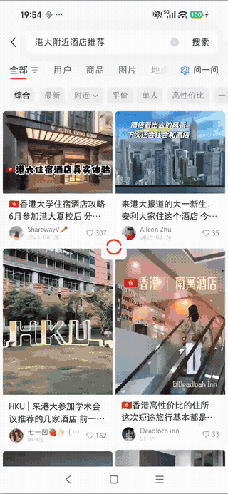

English · [Chinese](README_CN.md)

<div align="center">

# PhoneGo: Your AI Agent on Your Phone

**A phone agent that works on a screen of its own — so the one in your hand stays yours.**

<p>
  <a href="https://github.com/HKUDS/PhoneCLI/releases/download/phonego-v0.3.0/PhoneGo-0.3.0-arm64.apk"></a>
  <a href="docs/README.md"></a>
  <a href='https://github.com/HKUDS/OpenPhone'></a>
</p>
<p>
  <a href="https://github.com/HKUDS/PhoneCLI/stargazers"></a>
  <a href="./Communication.md"></a>
  <a href="./Communication.md"></a>
  <a href=""></a>
  <a href="./README_CN.md"></a>
  <a href='https://arxiv.org/abs/2609.35671'></a>
  <a href='https://arxiv.org/abs/2510.22009'></a>
</p>

</div>

You type a sentence. PhoneGo opens the app, does the work, and tells you what it
found — while you keep using your phone. If it has to borrow your screen for an app
that refuses to run anywhere else, it says so, and gives the screen back when the
step is done.

It is not another chat window over a vision model. Most of what an agent does on a
phone is **navigation**: opening, tapping, scrolling, going back. PhoneGo compiles
that navigation offline into a map, replays it deterministically, and only asks a
model about the parts a map cannot cover.

## ✨ What makes it different

| | |
|---|---|
| 📵 **It doesn't take the phone** | The app is driven on a screen of its own, invisible to you. Some apps only run on the main screen; PhoneGo follows them there, finishes, and puts them back. |
| 🧭 **It doesn't guess every step** | Navigation comes from a map compiled offline: one deterministic replay, **zero model calls**, sub-second per step. |
| 👁 **It knows when to look** | When a map does not apply, PhoneGo falls back to a vision model and works that screen like a person would — then hands you a plain answer, not a log. |
| 🔗 **It crosses apps** | What it reads in one app it uses in the next: *"see which hotel Xiaohongshu recommends, then check tonight's price on Ctrip"*. |
| ↩️ **It gives the phone back** | When the task ends the app returns to its own screen, the chat comes forward, and it asks whether you want that page moved over to continue. |
| 🔒 **It stays on your device** | Pairing keys, maps, sessions and settings live in the app. Only the screenshots a model actually needs are sent. |

## 🎬 What a task looks like

```
you   find a hotel near HKU on Xiaohongshu, pick one, then check tonight's price on Ctrip

app   · Xiaohongshu: search → open a note → "Hopewell Hotel"
      · Ctrip: search Hopewell Hotel → 17-18 Nov
      · tonight: "no rooms for the dates you picked"; next available --
        18-19 Nov from CNY 3379 · 19-20 Nov from CNY 3790 · 20 Nov from CNY 2303
      · want me to move this hotel page to your phone to continue?
```

49 steps, 200 seconds, one instruction, two apps.

<p align="center">
  
</p>

## ⚙️ How it works

```
offline    a crawler walks an app and compiles it into a map   (once per app)
online     route the task -> replay the map's macro            (0 model calls)
fallback   unknown screen -> vision model drives that part     (only there)
```

The routing step is one small text call. The replay is deterministic — the same
taps, in the same order, every time. The vision model is the exception handler,
not the engine, which is why a task can finish in a minute instead of five.

## 📊 Measured on a real phone

| Task | Map + replay | Vision only |
|---|---|---|
| Find how to book a HKU visit (Xiaohongshu) | **17 steps / 64 s / 92k tokens** | 32 steps / 146 s / 207k tokens |

Same phone, same instruction, both successful. The recordings live in
[docs/showcase/](docs/showcase/).

## 📲 Install

1. Download `PhoneGo-0.3.0-arm64.apk` (**Android 14+, arm64**) and open it. Allow
   installation from this source; MIUI asks once (tap "continue").
2. Turn on **wireless debugging**, and enable PhoneGo's **accessibility service** —
   the app pairs itself with the phone's own `adbd`, no computer needed.
3. Open Settings and paste your own **model API key** (DeepSeek, or any OpenAI- or
   Anthropic-compatible endpoint). Nothing is bundled.
4. Type an instruction.

Updates install in place: every release is signed with the same key.

## ❓ Questions people ask

**Does it upload my screen?**
Only the screenshots a model call needs, to the endpoint you configured. Maps,
sessions, pairing keys and settings never leave the app.

**Do I need a computer?**
No. The app uses the phone's own wireless-debugging connection; the same code
also runs from a laptop over USB for development.

**Which apps work?**
Any app you can drive by tapping. Apps with a map replay in seconds; the rest go
through the vision fallback, which is slower and costs model calls. Maps are built
per app, on your phone, and can be rebuilt any time.

**Will it buy things for me?**
No. Anything that spends money (pay, order, submit) stops and asks first, and
password or verification-code screens are handed to you.

## 📚 Documentation

| | |
|---|---|
| [docs/product-app.md](docs/product-app.md) | what the app is, layer by layer |
| [docs/map-building.md](docs/map-building.md) | how a map is compiled, with the measurement behind each decision |
| [android-app/README.md](android-app/README.md) | build it: Gradle, Chaquopy, the virtual-display helper |
| [docs/showcase/](docs/showcase/) | recordings, including the side-by-side comparison |

## 🌟 Citation

If you find this work helpful to your research, please kindly consider citing our paper.

```
@article{jiang2026phonecli,
  title={PhoneCLI: From App Interfaces to Callable Commands for Mobile Agents},
  author={Jiang, Yangqin and Xu, Lingrui and Huang, Chao},
  journal={arXiv preprint arXiv:2609.35671},
  year={2026}
}

@inproceedings{jiang2026openphone,
  title={OpenPhone: Mobile Agentic Foundation Models},
  author={Jiang, Yangqin and Huang, Chao},
  booktitle={Findings of the Association for Computational Linguistics: ACL 2026},
  pages={30362--30380},
  year={2026}
}
```

---

## 🔗 Related Projects

PhoneGo builds on PhoneCLI and OpenPhone, which in turn build upon excellent open-source projects. We sincerely thank their authors and contributors:

- [AndroidLab](https://github.com/THUDM/Android-Lab) - The benchmark framework.
- [R1-V](https://github.com/StarsfieldAI/R1-V) - Implementation details for the GRPO training methodology.
- [LLaMA Factory](https://github.com/hiyouga/LLaMA-Factory) - The unified training framework enabling efficient model fine-tuning.

The CLI side of this repository (`phonecli/`, the evaluation suites, the training recipe) is unchanged; its original README is kept at [docs/archive/README-phonecli-en.md](docs/archive/README-phonecli-en.md).

---

## 📜 License

This project is released under the [MIT License](./LICENSE).

<div align="center">

**If this project helps you, please give us a Star🌟**

**🤖 Empower AI Phone with Agents!**

<br>

<p align="center">
  <em> ❤️ Thanks for visiting ✨ PhoneGo!</em><br><br>
  
</p>

</div>
