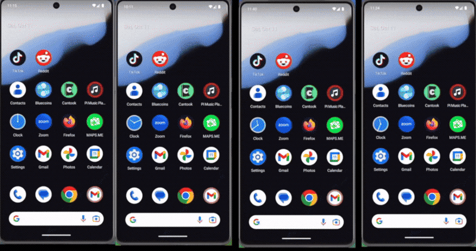
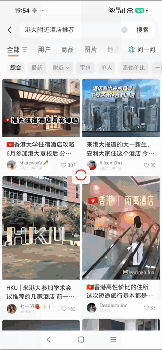

[English](README.md) · 中文

<div align="center">

# PhoneGo：你手机上的 AI 智能体

**一个住在你手机里的 AI agent —— 把 App 的界面变成可调用的命令。**

<p>
  <a href="https://github.com/HKUDS/PhoneCLI/releases/download/phonego-v0.3.0/PhoneGo-0.3.0-arm64.apk"></a>
  <a href="docs/README.zh.md"></a>
  <a href='https://github.com/HKUDS/OpenPhone'></a>
</p>
<p>
  <a href="https://github.com/HKUDS/PhoneCLI/stargazers"></a>
  <a href="./Communication.md"></a>
  <a href="./Communication.md"></a>
  
  <a href="./README.md"></a>
  <a href='https://arxiv.org/abs/2609.35671'></a>
  <a href='https://arxiv.org/abs/2510.22009'></a>
</p>

</div>

PhoneGo 直接跑在手机里。你说一句话，它打开 App、把事情做完、把结果告诉你——
这期间你照常用手机。少数 App 只肯在主屏跑、必须借用一下你的屏幕时，它会先说明，
做完再把屏幕还给你。

底下是 PhoneCLI 的思路。手机上 agent 做的大部分事其实是**导航**——打开、点击、滑动、
返回——这不该由模型去干。任务会经过的那些界面被离线编译成一张地图，运行时 agent
**调用命令**，而不是每一步都问模型该干什么：重放一步只要毫秒级，而且每次结果都一样。
视觉模型只在遇到地图没覆盖的界面时才被叫来。

<p align="center">
  
</p>

## ✨ 它和别的不一样在哪

| | |
|---|---|
| 🧭 **调用命令，而不是每步靠猜** | 导航离线编译成地图：一次确定性重放，**不调用视觉模型**，每一次点击都在亚秒级完成。 |
| 👁 **地图覆盖不到时才看图** | 没见过的界面才交给视觉模型，只处理那一部分——最后给你一句人话，而不是一堆日志。 |
| 🔗 **读到的东西能跨 App 用** | 在一个 App 里读到的信息，直接用在下一个：*"小红书看看推荐哪家酒店，再去携程查今晚多少钱"*。 |
| 📵 **不占用你的屏幕** | 目标 App 在一块它自己的、你看不见的屏上运行。少数 App 只肯在主屏跑，遇到这种它会跟过去做完，再搬回来。 |
| ↩️ **做完把屏幕还给你** | 任务结束时目标 App 回到它自己的屏，对话回到前台，并问你要不要把那个页面切过来继续操作。 |
| 🔒 **数据留在手机上** | 配对密钥、地图、会话、设置都在 App 里；只有模型调用真正需要看的那几个界面会发出去。 |

## 🎬 一条任务长什么样

```
你     小红书看看港大附近推荐哪家酒店，挑一家，再去携程查这家今晚多少钱

App    · 小红书：搜索 → 打开一篇笔记 →「合和酒店」
       · 携程：搜索「合和酒店」→ 11月17日–18日
       · 今晚「您选的日期暂无可预订房型」，最近可订：
         11/18–19 ¥3379 起 · 11/19–20 ¥3790 起 · 11/20 ¥2303 起
       · 需要我把这个酒店页面转到你的手机上继续操作吗？
```

<p align="center">
  
</p>

## ⚙️ 从界面到命令

```
离线     爬虫走一遍 App，把它编译成一张地图          （每个 App 一次）
在线     任务路由 → 重放地图里的宏                  （一次很小的路由调用）
兜底     地图没覆盖的界面 → 视觉模型只处理那一部分   （仅在那里）
```

地图每个 App 编译一次：每个界面是一个节点，每个能走通下一步的元素是一条边，一条任务
因此变成一串有序的步骤。跑这串步骤就是快的那条路——同一句指令 64 秒，纯看图要 146 秒；
视觉模型始终是"异常处理"，不是引擎。

## 📊 真机实测

| 任务 | 地图 + 重放 | 纯看图 |
|---|---|---|
| 查香港大学参观怎么预约（小红书） | **17 步 / 64 秒 / 92.3k token** | 32 步 / 146 秒 / 207.1k token |

同一台手机、同一句指令，两条都完成了。录像在 [docs/showcase/](docs/showcase/)。

## 📲 安装

1. 下载 `PhoneGo-0.3.0-arm64.apk`（**Android 14 及以上、arm64**），在手机上打开安装。
   需要允许"安装未知来源应用"；MIUI 会弹一次确认（继续安装）。
2. 打开**无线调试**，然后启用 PhoneGo 的**无障碍服务**：App 需要从系统弹窗里读出配对码，
   才能和手机上的 `adbd` 自己配对，所以无障碍要**先**打开。不需要电脑。
3. 打开「设置」，填入你自己的**模型 API Key**（DeepSeek，或任何 OpenAI / Anthropic
   兼容的接口）。App 不内置任何密钥。
4. 输入一句指令。

升级直接覆盖安装：每个版本都用同一把密钥签名。

## ❓ 常见问题

**会把我的屏幕传上去吗？**
只有模型调用真正需要看的那几个界面会发到你配置的接口。地图、会话、配对密钥和设置不出 App。

**需要电脑吗？**
不需要。App 用的是手机自己的无线调试通道；同一套代码在开发时也能从电脑走 USB 跑。

**哪些 App 能用？**
能用手指点的都能用。有地图的 App 跑同一条任务会快好几倍；没有的走视觉兜底，会慢一些、也更费模型调用。
地图是按 App 在你手机上建的，随时可以重建。

**会替我买东西吗？**
不会。涉及花钱的动作（支付 / 下单 / 提交订单）会先停下来问你；密码、验证码这类界面会交给你处理。

## 📚 文档

| | |
|---|---|
| [docs/product-app.zh.md](docs/product-app.zh.md) | 这个 App 是什么，逐层拆开讲 |
| [docs/map-building.zh.md](docs/map-building.zh.md) | 地图怎么编译，每处改动背后的实测 |
| [android-app/README.zh.md](android-app/README.zh.md) | 怎么构建：Gradle、Chaquopy、虚拟屏 helper |
| [docs/showcase/](docs/showcase/) | 录像，包括两种模式的并排对比 |

## 🌟 引用

如果这个项目对你的研究有帮助，欢迎引用我们的论文。

```
@article{jiang2026phonecli,
  title={PhoneCLI: From App Interfaces to Callable Commands for Mobile Agents},
  author={Jiang, Yangqin and Xu, Lingrui and Huang, Chao},
  journal={arXiv preprint arXiv:2609.35671},
  year={2026}
}

@inproceedings{jiang2026openphone,
  title={OpenPhone: Mobile Agentic Foundation Models},
  author={Jiang, Yangqin and Huang, Chao},
  booktitle={Findings of the Association for Computational Linguistics: ACL 2026},
  pages={30362--30380},
  year={2026}
}
```

---

## 🔗 相关项目

PhoneGo 建立在 PhoneCLI 与 OpenPhone 之上，二者又受益于这些优秀的开源项目，在此感谢他们的作者与贡献者：

- [AndroidLab](https://github.com/THUDM/Android-Lab) —— 评测框架。
- [R1-V](https://github.com/StarsfieldAI/R1-V) —— GRPO 训练方法的实现细节。
- [LLaMA Factory](https://github.com/hiyouga/LLaMA-Factory) —— 统一的训练框架，让微调更高效。

仓库里的 CLI 部分（`phonecli/`、评测套件、训练配方）没有改动；原始 README 保留在 [docs/archive/README-phonecli-zh.md](docs/archive/README-phonecli-zh.md)。

---

## 📜 许可

本项目以 [MIT License](./LICENSE) 发布。

<div align="center">

**如果这个项目对你有帮助，欢迎给个 Star🌟**

**🤖 Empower AI Phone with Agents!**

<br>

<p align="center">
  <em> ❤️ 感谢访问 ✨ PhoneGo！</em><br><br>
  
</p>

</div>
