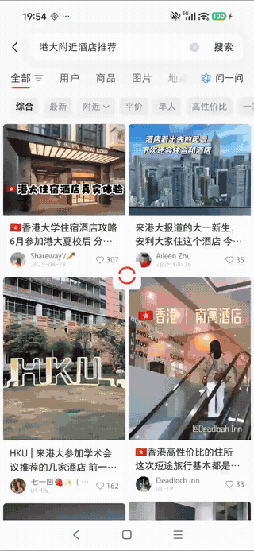
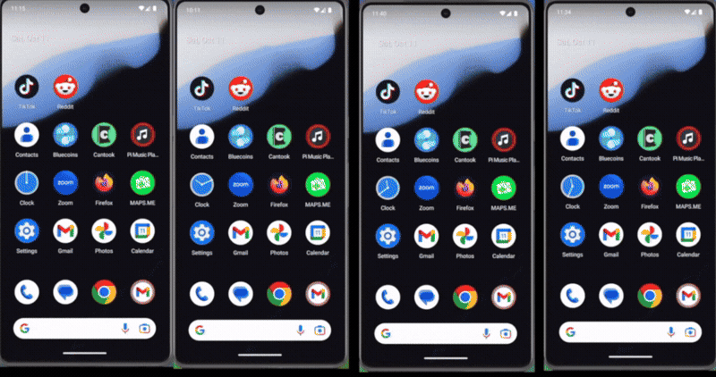

[English](README.md) · [中文](README_CN.md) · 日本語

<div align="center">

# PhoneGo: スマートフォン上のパーソナル AI エージェント

**CLI+GUI · 高速 · 強力 · 高信頼 · 低コストなスマートフォン操作エージェント**

<p>
  <a href="https://github.com/HKUDS/PhoneGo/releases/download/phonego-v0.4.0/PhoneGo-0.4.0-arm64.apk"></a>
  <a href="#-phonego-の使い方"></a>
</p>
<p>
  <a href="./Communication.md"></a>
  <a href="./Communication.md"></a>
  <a href='https://arxiv.org/abs/2609.35671'></a>
  <a href='https://arxiv.org/abs/2510.22009'></a>
</p>

</div>

PhoneGo をダウンロードして、Android スマートフォン上で直接実行できます。

やりたいことを PhoneGo に伝えるだけです。PhoneGo が適切なアプリを開いて操作し、タスクを完了して、結果を報告します。

- スマートフォン上で直接**ダウンロードして実行**できます。
- 自然言語で**タスクを説明**します。
- 関連するアプリの**操作を PhoneGo に任せ**ます。
- **PhoneGo はバックグラウンドで動作する**ため、その間もスマートフォンを自由に使えます。
- タスクが完了したら**結果を受け取り**ます。

## PhoneGo は何が違うのか？

### ⚡ 再利用可能なアプリコマンド

PhoneGo は、よく使うアプリの操作手順を再利用可能なコマンドに変換します：

- 特定のページを開く。
- 情報を検索する。
- 予約などの複数ステップのタスクを完了する。
- テスト済みのワークフローを、タップを 1 つずつ探し直すことなく再実行する。

**結果:** 実行がより速くなり、結果がより安定し、モデルの呼び出しが減ります。

### 📱 視覚によるアプリ操作

画面を直接操作する必要があるアプリでは、PhoneGo は次のことができます：

- 画面に表示されている内容を理解する。
- ボタンをタップし、メニューを移動する。
- ページをスクロールし、前の画面に戻る。
- 見慣れないインターフェースや予期しないアプリの状態に対処する。

**結果:** API や再利用可能なコマンドがない場合でも、PhoneGo はアプリを操作できます。

### 🔀 CLI（コマンド）+ GUI（視覚）による実行

PhoneGo は最適な方法を自動で選択します：

- 慣れた繰り返しのワークフローには**再利用可能なコマンド**。
- タップやスクロールが必要な場合は**視覚による操作**。
- 見慣れない画面や新しい状況でのみ**ビジョンモデル**。
- 同じタスクの中で、コマンドと視覚による操作を**シームレスに切り替え**。

**結果:** コマンドレベルの速度と信頼性に、人間のようなアプリ操作の柔軟性を兼ね備えます。

## 🎬 ユースケース

```
you   find a hotel near HKU on Xiaohongshu, pick one, then check tonight's price on Ctrip

app   · Xiaohongshu: search → open a note → "Hopewell Hotel"
      · Ctrip: search Hopewell Hotel → 17–18 Nov
      · tonight: "no rooms for the dates you picked". Next available —
        18–19 Nov from CNY 3379 · 19–20 Nov from CNY 3790 · 20 Nov from CNY 2303
      · want me to move this hotel page to your phone to continue?
```

<p align="center">
  
</p>


## ✨ PhoneGo の主な機能

| | |
|---|---|
| 🗺️ **アプリごとに実行可能なマップを構築** | 画面とナビゲーションの経路が、再利用可能なコマンドになります。 |
| 🧭 **タップを 1 つずつ推測せずにコマンドを呼び出す** | 既知の経路は、ビジョンの呼び出しなしで高速かつ決定論的に実行されます。 |
| 👁️ **マップが尽きたときだけ画面を見る** | 見慣れない画面や動的なコンテンツはビジョンで処理します。 |
| 🔀 **コマンドと視覚による操作を組み合わせる** | コマンドが速度をもたらし、視覚による操作が変化に対応します。 |
| 🔗 **アプリをまたいでコンテキストを引き継ぐ** | あるアプリで見つけた情報が、そのまま次のアプリに渡されます。 |
| 📵 **スマートフォンを占有せずに動作** | PhoneGo は可能な限りバックグラウンドで実行されます。 |
| ↩️ **完了したら操作を返す** | メイン画面は必要なときだけ使い、その後は返します。 |
| 🔒 **機密性の高い状態はデバイス上に保持** | マップ、キー、セッション、設定はローカルに残ります。 |

> **既知のことはコマンドが、新しいことはビジョンが処理します。**

<p align="center">
  
</p>

## ⚙️ アプリの画面から呼び出し可能なコマンドへ

PhoneGo は、事前に準備できることと、実行時に理解しなければならないことを分けて扱います：

```text
OFFLINE    Explore the app → Build its navigation map        (once per app)
ONLINE     Understand the task → Select and replay a command  (fast path)
FALLBACK   Encounter something new → Use visual interaction   (only when needed)
```

## 📊 実機でのテスト

同じスマートフォンで同じ指示を実行し、PhoneGo のマップとリプレイによる方法を、ビジョンのみのエージェントと比較しました。

| タスク | PhoneGo: マップ + リプレイ | ビジョンのみ |
|---|---:|---:|
| Xiaohongshu で HKU の見学予約の方法を調べる | **17 ステップ · 64 秒 · 92.3k トークン** | 32 ステップ · 146 秒 · 207.1k トークン |

どちらの方法もタスクを正常に完了しましたが、PhoneGo は次のように効率的でした：

- **ステップ数が 47% 少ない**
- **時間が 56% 短い**
- **トークン数が 55% 少ない**

この差は、シンプルな考え方から生まれています。慣れたナビゲーションは、1 ステップずつ視覚的に探し直すのではなく、テスト済みのコマンドとして再実行されるのです。

並べて比較した録画は [docs/showcase/](docs/showcase/) をご覧ください。

## 📲 PhoneGo の使い方

PhoneGo は Android スマートフォン上で直接動作し、コンピューターは不要です。

### 1. ダウンロードとインストール

**[PhoneGo-0.4.0-arm64.apk](https://github.com/HKUDS/PhoneGo/releases/download/phonego-v0.4.0/PhoneGo-0.4.0-arm64.apk)** をダウンロードします。

**動作要件:** Android 14+ · ARM64

APK を開き、このソースからのインストールを許可します。MIUI 端末では、確認が表示されたら **Continue** をタップします。

### 2. PhoneGo をスマートフォンに接続する

PhoneGo は、Android に組み込まれたワイヤレスデバッグを使って、アプリをローカルで操作します。

1. 開発者向けオプションで **Wireless debugging** をオンにします。
2. **PhoneGo Accessibility Service** を有効にします。
3. アプリ内のペアリング手順に従います。

PhoneGo はシステムのダイアログからペアリングコードを読み取り、スマートフォンのローカルの `adbd` サービスに自動で接続します。

> **USB ケーブルや別のコンピューターは必要ありません。**

### 3. モデルを接続する

**Settings → Model Settings** に移動します。

1. プロバイダーを選択します：
   - OpenRouter
   - DeepSeek
   - Zhipu
   - Alibaba Bailian
   - SiliconFlow
   - 独自の互換エンドポイント
2. API キーを入力します。
3. **Test Connection** をタップします。

PhoneGo にはモデルや API キーが同梱されていないため、使用するモデルのエンドポイントはご自身で管理できます。

### 4. PhoneGo にタスクを与える

自然言語でリクエストを入力します。

初めて実行するときは、ログインが不要なタスクを試してみてください：

> *設定を開いて、接続している Wi-Fi ネットワークを教えて。*

PhoneGo がアプリを開き、必要な手順を実行して、結果を報告します。

## 🌐 言語とアップデート

- PhoneGo は**英語と中国語**に対応しています。
- インターフェースは、デフォルトでスマートフォンのシステム言語に従います。
- **Settings → Language** で手動で変更することもできます。
- 新しいリリースは、現在の設定を削除せずに既存のバージョンの上からインストールできます。

画面付きの完全な手順とトラブルシューティングガイドについては、**[Getting Started](docs/getting-started.md)** をご覧ください。

## ❓ よくある質問

### PhoneGo は画面をアップロードしますか？

視覚的な理解が必要な場合のみです。

その場合、該当する画面が、ご自身で設定したモデルのエンドポイントに送信されます。次のものはデバイス上に残ります：

- アプリのナビゲーションマップ
- ペアリングキー
- セッション
- 設定
- 再利用可能なコマンド

既知のワークフローは、すべての画面をビジョンモデルに送信することなく、ローカルのマップから実行できます。

### コンピューターは必要ですか？

いいえ。

PhoneGo はスマートフォン上で直接動作し、Android に組み込まれたワイヤレスデバッグを通じて接続します。

開発用にコンピューターへの USB 接続もサポートしていますが、通常の使用には必要ありません。

### PhoneGo はどのアプリを操作できますか？

PhoneGo は、タップ、スクロール、テキスト入力で操作できるアプリに対応しています。

- **マップ済みのアプリ**は、慣れたナビゲーションに高速で再利用可能なコマンドを使います。
- **マップされていない画面**では、視覚による操作にフォールバックします。
- **インターフェースが変わった場合**は、再び探索してマップを再構築できます。

既存のマップがあるアプリは、通常より高速で、モデルの呼び出しも少なくて済みます。

### PhoneGo に購入を任せられますか？

PhoneGo は、確認なしに機密性の高い操作を完了することはありません。

支払い、注文、取引の送信などの操作の前には、一時停止して承認を求めます。

パスワード、認証コード、その他の機密性の高い認証手順は、ユーザーに操作を戻します。

## 📚 ドキュメント

どこから始めればよいかわからない場合は、まず **[Getting Started](docs/getting-started.md)** で PhoneGo をインストールし、最初のタスクを完了してみてください。

| ガイド | 内容 |
|---|---|
| 📘 **[ユーザーマニュアル](docs/manual.md)** | すべての画面、設定、機能、よくある問題を網羅した完全なガイドです。 |
| 🚀 **[Getting Started](docs/getting-started.md)** | APK のインストールから最初のタスクの完了までの手順を、ステップごとに説明します。 |
| 🧩 **[PhoneGo の仕組み](docs/product-app.md)** | PhoneGo の製品設計とシステムアーキテクチャをわかりやすく紹介します。 |
| 🗺️ **[アプリのナビゲーションマップの構築](docs/map-building.md)** | PhoneGo がアプリを探索し、その画面とナビゲーションの経路を再利用可能なコマンドにコンパイルする方法です。 |
| 🛠️ **[Android 開発ガイド](android-app/README.md)** | Gradle、Chaquopy、仮想ディスプレイのヘルパーを使って Android アプリをビルドする方法です。 |
| 🎬 **[例と録画](docs/showcase/)** | 実機でのデモと、ビジョンのみのエージェントとの並列比較です。 |

## 🌟 引用

PhoneGo は、2 つの研究プロジェクトを実用的なモバイルアプリケーションとして統合したものです：

- **PhoneCLI** は、アプリのナビゲーションマップ、コマンドのコンパイル、決定論的なリプレイを提供します。
- **OpenPhone** は、視覚的な理解とフォールバックの操作に使われるオープンなモバイルエージェントモデルを提供します。

PhoneGo、PhoneCLI、OpenPhone がご自身の研究に役立った場合は、対応する論文の引用をご検討ください：

```bibtex
@article{jiang2026phonecli,
  title   = {PhoneCLI: From App Interfaces to Callable Commands for Mobile Agents},
  author  = {Jiang, Yangqin and Xu, Lingrui and Huang, Chao},
  journal = {arXiv preprint arXiv:2609.35671},
  year    = {2026}
}

@inproceedings{jiang2026openphone,
  title     = {OpenPhone: Mobile Agentic Foundation Models},
  author    = {Jiang, Yangqin and Huang, Chao},
  booktitle = {Findings of the Association for Computational Linguistics: ACL 2026},
  pages     = {30362--30380},
  year      = {2026}
}
```

---

## 🔗 関連プロジェクト

- [AndroidLab](https://github.com/THUDM/Android-Lab)
- [R1-V](https://github.com/StarsfieldAI/R1-V)
- [LLaMA Factory](https://github.com/hiyouga/LLaMA-Factory)
- [Mika](https://github.com/wangzan101/Mika)

`phonecli/`、評価スイート、トレーニングのレシピを含む、元の PhoneCLI の研究コンポーネントは、引き続きこのリポジトリで利用できます。

元の PhoneCLI のドキュメントについては、**[アーカイブされた PhoneCLI README](docs/archive/README-phonecli-en.md)** をご覧ください。

---

## 📜 ライセンス

このプロジェクトは [MIT License](./LICENSE) のもとで公開されています。

<div align="center">

**このプロジェクトが役に立った場合は、Star🌟 をお願いします**

**🤖 エージェントで AI フォンを探求しよう！**

<br>

<p align="center">
  <em> ❤️ ✨ PhoneGo にお越しいただきありがとうございます！</em><br><br>
  
</p>

</div>
